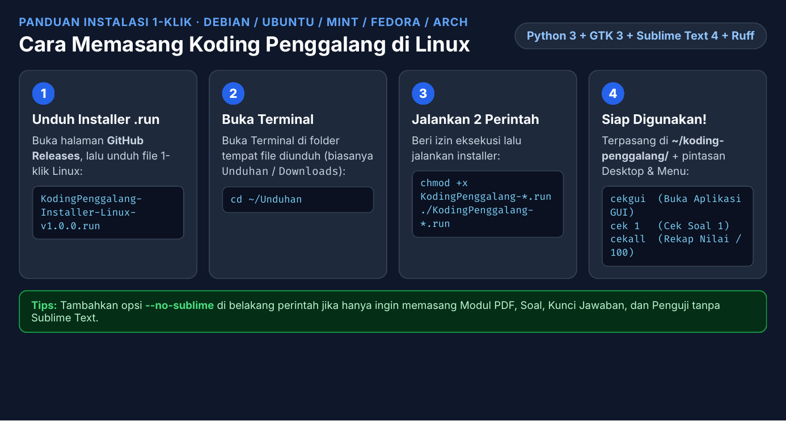

# Koding Penggalang — Modul, Installer & Penguji Lomba Coding Python 3 (SMP/MTs)

Paket lengkap belajar mandiri, latihan simulasi, installer 1-klik (**Linux & Windows**), serta alat penguji otomatis **CLI & GUI** untuk persiapan **Lomba Coding Python Pramuka Penggalang** (usia 11–15 tahun / jenjang SMP–MTs) di Indonesia.

Disusun secara faktual berdasarkan:
- Petunjuk Teknis (Juknis) Lomba Coding Python Penggalang
- **SK Kwarnas Gerakan Pramuka No. 198 Tahun 2011** (SKU Penggalang: Kompas, 16 Arah Mata Angin, Azimuth/Back Azimuth, Sandi, Morse Internasional, Semaphore, dan Lomba Tingkat)
- **Kurikulum Merdeka Informatika Fase D (SMP/MTs)** Kemendikbudristek
- **Bebras Indonesia** kategori Penggalang
- **Dokumentasi Resmi Python 3** (Python Software Foundation)

---

## Panduan Instalasi 1-Klik (Bergambar)

Unduh paket rilis di halaman **[GitHub Releases (`v1.0.0`)](https://github.com/zulfikriyahya/koding-penggalang/releases/latest)**.

### A. Windows 10 / 11


1. Unduh **`koding-penggalang-v1.0.0-windows.zip`** dari halaman **[Releases](https://github.com/zulfikriyahya/koding-penggalang/releases/latest)**.
2. Klik kanan file ZIP → pilih **Extract All...** (*Ekstrak Semua*).
3. Buka folder hasil ekstrak, lalu klik dua kali **`INSTALL_KODING_PENGGALANG.bat`**.
   - *(Jika muncul layar biru Windows Defender SmartScreen, klik **More info** → **Run anyway**.)*
4. Selesai! Pintasan **Penguji Koding Penggalang** dan **Modul PDF & Soal** langsung muncul di Desktop.

---

### B. Linux (Debian / Ubuntu / Mint / Fedora / Arch)



1. Unduh **`KodingPenggalang-Installer-Linux-v1.0.0.run`** dari halaman **[Releases](https://github.com/zulfikriyahya/koding-penggalang/releases/latest)**.
2. Buka Terminal di folder Unduhan, lalu jalankan:
   ```bash
   chmod +x KodingPenggalang-Installer-Linux-v1.0.0.run
   ./KodingPenggalang-Installer-Linux-v1.0.0.run
   ```
   *(Tambahkan `--no-sublime` di Linux atau `-NoSublime` di PowerShell Windows jika hanya ingin memasang modul & penguji tanpa Sublime Text.)*

---

### C. Unduh Langsung PDF, Contoh Soal & Kunci Jawaban (Tanpa Installer)
Di halaman **[Releases](https://github.com/zulfikriyahya/koding-penggalang/releases/latest)** tersedia langsung file siap unduh:
- `01_Modul_Belajar_Pemrograman_dan_Python3_Penggalang.pdf` *(7 halaman A4)*
- `02_Referensi_Cepat_Sintaks_Python3_Saat_Lomba.pdf` *(2 halaman A4 bolak-balik)*
- `03_Paket_Latihan_4_Soal_Lomba_Penggalang.pdf` *(2 halaman A4)*
- `Paket-Soal-dan-Kunci-Jawaban-v1.0.0.zip` *(semua PDF + HTML + template `latihan/` + `kunci_jawaban/` + penguji offline)*

---

## Tampilan Aplikasi Penguji Jawaban (GUI & Terminal)

### 1. Aplikasi Desktop GUI (`cekgui`) — GTK 3 (Linux) & Tkinter (Windows)
Satu klik untuk menguji 1 file atau 1 folder jawaban tim, memantau aturan Juknis (`input()` kosong), melihat tabel 20 kasus uji, serta membandingkan **Input Uji**, **Output Siswa**, dan **Kunci Jawaban** secara berdampingan:


### 2. Penguji Terminal Cepat (`cek` / `cekall`)


```bash
cek soal1_ELANG.py        # Uji 1 file jawaban (deteksi nomor soal otomatis)
cek 1                     # Uji cepat Soal 1 (atau 2, 3, 4)
cek 3 jawaban_morse.py    # Uji file dengan nomor soal manual
cekall                    # Uji semua soal 1–4 + rekap skor 0–100
cek folder_tim/           # Uji seluruh jawaban 1 tim + rekap skor 0–100
cekgui                    # Buka aplikasi desktop GUI
```

---

## Paket 4 Soal Simulasi (120 Menit · Skor 0–100)

| Soal | Topik Kepramukaan | Tingkat | Bobot |
|---|---|---|---|
| **Soal 1** | Kompas, Azimuth, Back Azimuth & 8 Arah Mata Angin | Mudah | 25% |
| **Soal 2** | Logistik Tenda & Kebutuhan Air Perkemahan | Mudah–Menengah | 25% |
| **Soal 3** | Penerjemah Sandi Morse Internasional (`A`–`Z`, `0`–`9`) | Menengah | 25% |
| **Soal 4** | Klasemen Lomba Tingkat (LT) Penggalang | Menantang | 25% |

> **Aturan Penting Juknis:** Semua pemanggilan `input()` **wajib kosong** tanpa teks di dalam tanda kurung (tulis `x = input()`, bukan `x = input("Masukkan: ")`). Penguji otomatis akan langsung memberi peringatan jika aturan ini terlanggar.

---

## Struktur Proyek

```text
koding-penggalang/
├── docs/images/              # Gambar panduan instalasi & screenshot aplikasi
├── modul/                    # 3 dokumen final PDF & HTML siap cetak / Google Docs
├── latihan/                  # Template jawaban siswa (soal1_ELANG.py .. soal4_ELANG.py)
├── kunci_jawaban/            # Kunci jawaban terverifikasi 100% (soal1_kunci.py .. soal4_kunci.py)
├── penguji/core.py           # Mesin penguji offline (20 kasus uji + validator Juknis AST)
├── installer/                # Installer 1-klik Linux & Windows + Sublime Text Python Helper
├── cek_jawaban.py            # Penguji otomatis lewat terminal (CLI)
└── cek_jawaban_gui.py        # Aplikasi penguji grafis desktop (GTK 3 Linux + Tkinter Windows)
```

---

## Lisensi & Penggunaan
Bebas digunakan, dicetak, dan dimodifikasi untuk keperluan latihan ekstrakurikuler Pramuka Penggalang, pembinaan Informatika SMP/MTs, dan simulasi lomba koding di Indonesia.
