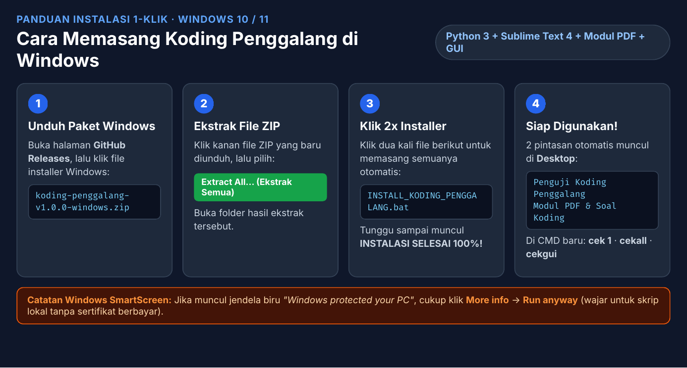
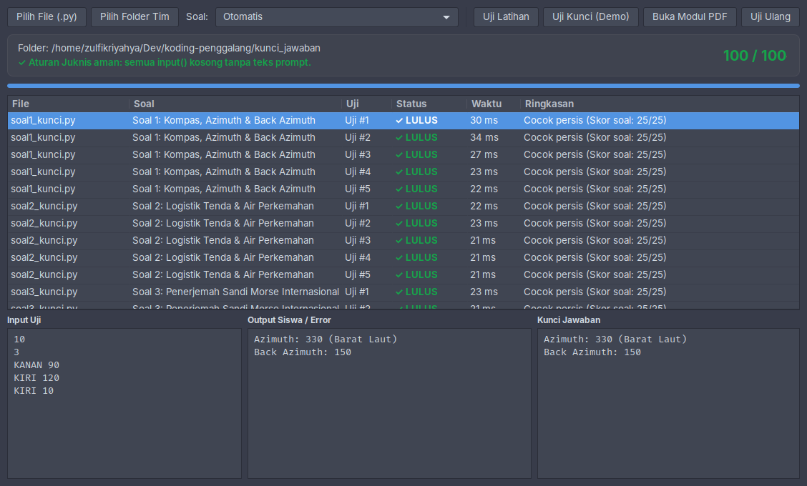
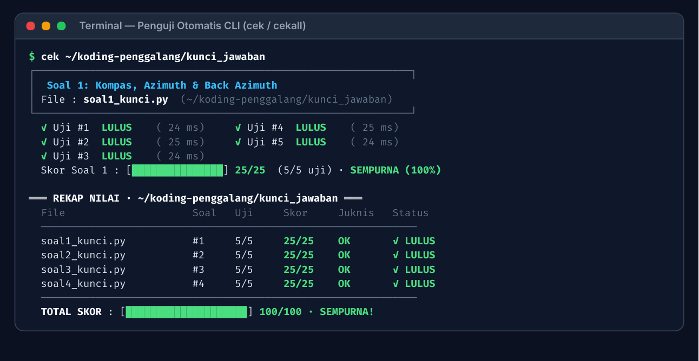

# Koding Penggalang — Modul, Installer & Penguji Lomba Coding Python 3 (SMP/MTs)

Paket lengkap belajar mandiri, latihan simulasi, installer 1-klik (**Linux & Windows**), serta alat penguji otomatis **CLI & GUI** untuk persiapan **Lomba Coding Python Pramuka Penggalang** (usia 11–15 tahun / jenjang SMP–MTs) di Indonesia.

Disusun secara faktual berdasarkan:
- Petunjuk Teknis (Juknis) Lomba Coding Python Penggalang
- **SK Kwarnas Gerakan Pramuka No. 198 Tahun 2011** (SKU Penggalang: Kompas, 16 Arah Mata Angin, Azimuth/Back Azimuth, Sandi, Morse Internasional, Semaphore, dan Lomba Tingkat)
- **Kurikulum Merdeka Informatika Fase D (SMP/MTs)** Kemendikbudristek
- **Bebras Indonesia** kategori Penggalang
- **Dokumentasi Resmi Python 3** (Python Software Foundation)

---

## Panduan Instalasi 1-Klik (Bergambar)

Unduh paket rilis di halaman **[GitHub Releases (`v1.0.0`)](https://github.com/zulfikriyahya/koding-penggalang/releases/latest)**.

### A. Windows 10 / 11



1. Unduh **`koding-penggalang-v1.0.0-windows.zip`** dari halaman **[Releases](https://github.com/zulfikriyahya/koding-penggalang/releases/latest)**.
2. Klik kanan file ZIP → pilih **Extract All...** (*Ekstrak Semua*).
3. Buka folder hasil ekstrak, lalu klik dua kali **`INSTALL_KODING_PENGGALANG.bat`**.
   - *(Jika muncul layar biru Windows Defender SmartScreen, klik **More info** → **Run anyway**.)*
4. Selesai! Pintasan **Penguji Koding Penggalang** dan **Modul PDF & Soal** langsung muncul di Desktop.

---

### B. Linux (Debian / Ubuntu / Mint / Fedora / Arch)


1. Unduh **`KodingPenggalang-Installer-Linux-v1.0.0.run`** dari halaman **[Releases](https://github.com/zulfikriyahya/koding-penggalang/releases/latest)**.
2. Buka Terminal di folder Unduhan, lalu jalankan:
   ```bash
   chmod +x KodingPenggalang-Installer-Linux-v1.0.0.run
   ./KodingPenggalang-Installer-Linux-v1.0.0.run
   ```
   *(Tambahkan `--no-sublime` di Linux atau `-NoSublime` di PowerShell Windows jika hanya ingin memasang modul & penguji tanpa Sublime Text.)*

---

### C. Unduh Langsung PDF, Contoh Soal & Kunci Jawaban (Tanpa Installer)
Di halaman **[Releases](https://github.com/zulfikriyahya/koding-penggalang/releases/latest)** tersedia langsung file siap unduh:
- `01_Modul_Belajar_Pemrograman_dan_Python3_Penggalang.pdf` *(7 halaman A4)*
- `02_Referensi_Cepat_Sintaks_Python3_Saat_Lomba.pdf` *(2 halaman A4 bolak-balik)*
- `03_Bank_16_Soal_Latihan_Lomba_Penggalang.pdf` *(8 halaman A4 — 4 Paket Simulasi × 4 Soal = 16 Soal!)*
- `Paket-Soal-dan-Kunci-Jawaban-v1.0.0.zip` *(semua PDF + HTML + 16 template `latihan/` + 16 `kunci_jawaban/` + penguji offline 80 kasus uji)*

---

## Tampilan Aplikasi Penguji Jawaban (GUI & Terminal)

### 1. Aplikasi Desktop GUI (`cekgui`) — GTK 3 (Linux) & Tkinter (Windows)
Satu klik untuk menguji 1 file atau 1 folder jawaban tim, memantau aturan Juknis (`input()` kosong), melihat tabel hingga 80 kasus uji, serta membandingkan **Input Uji**, **Output Siswa**, dan **Kunci Jawaban** secara berdampingan:



### 2. Penguji Terminal Cepat (`cek` / `cekall`)



```bash
cek soal1_ELANG.py        # Uji 1 file jawaban (deteksi nomor soal 1–16 otomatis)
cek 1                     # Uji cepat Soal 1 (bisa 1 s/d 16)
cek 15 jawaban_sem.py     # Uji file dengan nomor soal manual (1–16)
cek paket1                # Uji Paket 1 (Soal 1–4, skor /100) — bisa paket1..paket4
cekall                    # Uji semua 16 soal + rekap nilai lengkap
cek folder_tim/           # Uji seluruh jawaban 1 tim + rekap nilai
cekgui                    # Buka aplikasi desktop GUI
```

---

## Bank 16 Soal Simulasi (4 Paket × 4 Soal · 80 Kasus Uji)

Setiap paket dirancang mengikuti format resmi Juknis (**4 soal × 25% = 100 poin, 120 menit**):

### Paket 1 — Dasar & Teknik Kepramukaan Inti (`cek paket1`)
| Soal | Topik Kepramukaan | Tingkat | Bobot |
|---|---|---|---|
| **Soal 1** | Kompas, Azimuth, Back Azimuth & 8 Arah Mata Angin | Mudah | 25% |
| **Soal 2** | Logistik Tenda & Kebutuhan Air Perkemahan | Mudah–Menengah | 25% |
| **Soal 3** | Penerjemah Sandi Morse Internasional (`A`–`Z`, `0`–`9`) | Menengah | 25% |
| **Soal 4** | Klasemen Lomba Tingkat (LT) Penggalang | Menantang | 25% |

### Paket 2 — Sandi, Menaksir, Peta Perjalanan & Logistik (`cek paket2`)
| Soal | Topik Kepramukaan | Tingkat | Bobot |
|---|---|---|---|
| **Soal 5** | Penerjemah Sandi AN & Sandi AZ | Mudah | 25% |
| **Soal 6** | Menaksir Tinggi Pohon (Metode Bayangan Tongkat) | Mudah–Menengah | 25% |
| **Soal 7** | Peta Perjalanan & Estimasi Waktu Tiba Pos | Menengah | 25% |
| **Soal 8** | Inventaris & Kekurangan Peralatan Regu | Menengah–Menantang | 25% |

### Paket 3 — Semboyan, Sandi Lanjutan, Jadwal & Penilaian (`cek paket3`)
| Soal | Topik Kepramukaan | Tingkat | Bobot |
|---|---|---|---|
| **Soal 9** | Penerjemah Sandi Angka Pramuka (`1`–`26`, `0`=spasi) | Mudah | 25% |
| **Soal 10** | Sandi Geser (Caesar) Multi-Baris (`ENKRIPSI`/`DEKRIPSI`) | Menengah | 25% |
| **Soal 11** | Penjadwalan Piket & Jaga Malam Perkemahan (24-jam) | Menengah | 25% |
| **Soal 12** | Rekap Juara Umum (Penalti Keterlambatan & Diskualifikasi) | Menantang | 25% |

### Paket 4 — Berpikir Komputasional (Bebras) & Simulasi Final (`cek paket4`)
| Soal | Topik Kepramukaan | Tingkat | Bobot |
|---|---|---|---|
| **Soal 13** | Simulasi Tali Pionering (Pemotongan & Sisa Tali) | Mudah–Menengah | 25% |
| **Soal 14** | Jejak Langkah Penjelajahan (Koordinat Grid, Manhattan & Euclidean) | Menengah | 25% |
| **Soal 15** | Penerjemah Posisi Bendera Semaphore Resmi (7 Lingkaran `A`–`Z`) | Menengah–Menantang | 25% |
| **Soal 16** | Optimasi Isi Ransel Perkemahan (*Greedy* Prioritas & Berat) | Menantang | 25% |

> **Aturan Penting Juknis:** Semua pemanggilan `input()` **wajib kosong** tanpa teks di dalam tanda kurung (tulis `x = input()`, bukan `x = input("Masukkan: ")`). Penguji otomatis akan langsung memberi peringatan jika aturan ini terlanggar.

---

## Struktur Proyek

```text
koding-penggalang/
├── docs/images/              # Gambar panduan instalasi & screenshot aplikasi
├── modul/                    # 3 dokumen final PDF & HTML siap cetak / Google Docs
├── latihan/                  # Template jawaban siswa (soal1_ELANG.py .. soal4_ELANG.py)
├── kunci_jawaban/            # Kunci jawaban terverifikasi 100% (soal1_kunci.py .. soal4_kunci.py)
├── penguji/core.py           # Mesin penguji offline (20 kasus uji + validator Juknis AST)
├── installer/                # Installer 1-klik Linux & Windows + Sublime Text Python Helper
├── cek_jawaban.py            # Penguji otomatis lewat terminal (CLI)
└── cek_jawaban_gui.py        # Aplikasi penguji grafis desktop (GTK 3 Linux + Tkinter Windows)
```

---

## Lisensi & Penggunaan
Bebas digunakan, dicetak, dan dimodifikasi untuk keperluan latihan ekstrakurikuler Pramuka Penggalang, pembinaan Informatika SMP/MTs, dan simulasi lomba koding di Indonesia.
